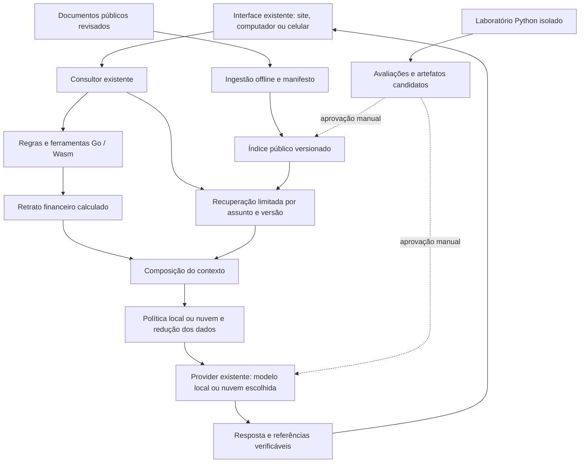

# IA especializada da Rich: arquitetura e roteiro

Data da análise: 25/11/2026. Estado: **laboratório local autorizado; restante em proposta**.
O Qwen3.5-4B foi baixado pelo Ollama para avaliação, sem treinamento ou troca no app.
Execução reproduzível: [laboratório local](../../../tools/ai-lab/README.md).
Este documento descreve o destino pretendido, não funcionalidades já entregues.
O contrato verificável está em [specs/specialized-financial-ai/spec.md](specs/specialized-financial-ai/spec.md)
e a sequência de execução em [tasks.md](tasks.md).

## 1. Objetivo e vocabulário

Ajudar a pessoa a entender gastos, organizar dívidas e planejar metas em português claro.
Esse recorte inicial é recomendado e ainda precisa de confirmação.

- **Inferência:** executar um modelo para responder; não altera seus pesos.
- **RAG:** recuperar documentos relevantes para fundamentar a resposta; não é treinamento dos pesos.
- **Fine-tuning:** ajustar pesos ou adaptadores com exemplos supervisionados.
- **LoRA:** técnica de ajuste com um conjunto menor de parâmetros treináveis.
- **IA própria:** experiência, conhecimento, avaliações e, se justificado, adaptadores da Rich.
  Não significa que a Rich criou ou detém o modelo-base de terceiros.

## 2. O que já existe e será preservado

| Fronteira | Evidência no código | Papel atual |
|---|---|---|
| Consultor | `internal/advisor/advisor.go` | Instruções, contexto, histórico e ferramentas |
| Conhecimento | `internal/advisor/knowledge.go` | Seleção lexical de até dois assuntos; não há busca vetorial nesse arquivo |
| Ferramentas | `internal/advisor/tools.go`, `persona_tools.go` | Operações disponíveis ao modelo e respostas estruturadas |
| Respostas locais | `internal/advisor/offline.go` | Respostas determinísticas sem depender de uma IA disponível |
| Categorização | `internal/advisor/categorize.go` | Base existente a avaliar antes de criar outro classificador |
| Provedores | `internal/llm/llm.go`, `ollama.go`, `openai.go` | Interface `Provider.Chat`, streaming e chamadas de ferramentas |
| Privacidade | `internal/advisor/anon.go` | Substituição de nomes por apelidos; notas excluídas da cópia do livro financeiro |
| Avaliações | `internal/advisor/eval_test.go` | Casos financeiros e personas; execução real é opt-in |
| Regras | `internal/finance`, `internal/money`, `internal/wasmapi` | Cálculos em Go e WebAssembly; dinheiro em centavos |
| Nuvem | `internal/proxy`, `cmd/api` | Intermediário existente; não é um servidor de GPU |

Site e celular já podem usar a IA grátis da Rich por padrão; no computador, o envio à
nuvem depende da escolha da pessoa. Preservar essa diferença e o desligamento salvo.
Ver [mudança existente](../free-ai-by-default/design.md) e [IA grátis](../../../docs/IA-GRATIS.md).

## 3. Modelos candidatos, não escolhas aprovadas

| Papel | Candidato | Como decidir |
|---|---|---|
| Conversa | `Qwen/Qwen3.5-4B` | Português, ferramentas, respostas seguras, latência e memória |
| Recuperação semântica | `Qwen/Qwen3-Embedding-0.6B` | Recuperação de trechos em português contra busca lexical |
| Referência | Modelo já configurado no ambiente de teste | Medir se a mudança realmente melhora a Rich |

As fichas oficiais dos dois candidatos declaram Apache 2.0. Cada distribuição quantizada,
adaptador e conjunto de dados também precisa de origem e licença verificadas.
O Qwen3.5-4B é multimodal; o primeiro experimento será textual. Não copiar um exemplo de
`text-generation` de outro modelo sem conferir sua API e o template de conversa.

O ambiente observado tem Apple M1 Pro e 16 GiB de memória unificada. Propor inferência
quantizada em 4 bits e contexto curto como ponto de partida, não como garantia de execução.
Registrar formato, revisão exata, quantizador, tamanho, contexto e pico real de memória.
Treinamento tem consumo diferente da inferência; só um piloto pode confirmar sua viabilidade.

## 4. Arquitetura proposta



### Separação das responsabilidades

1. **Go/Wasm:** dados reais, cálculos, permissões, validação de argumentos e confirmação de alterações.
2. **Recuperação:** localizar trechos públicos pertinentes. Nunca transforma documentos em comandos.
3. **Modelo:** explicar números e sugerir próximos passos; não é a fonte da verdade contábil.
4. **Laboratório Python:** preparar exemplos, medir qualidade e experimentar LoRA fora do runtime do app.
5. **Provedor:** preservar `Provider.Chat`; RAG é composição de contexto, não motivo para substituir a interface.

Não criar FastAPI, PostgreSQL, MLflow ou banco vetorial externo sem uma necessidade medida.
Começar pela busca lexical existente como referência. Comparar busca lexical, semântica e,
se necessário, híbrida. Um índice pequeno pode ser um artefato local; escolher armazenamento
somente após medir volume, atualização e consumo. Não importar `store`/SQLite nos pacotes Wasm.

### Topologias e limites

- **Laboratório:** modelo local em Ollama, aproveitando o adaptador atual; Python só onde necessário.
- **Computador:** pode acessar o modelo local configurado e o índice público aprovado.
- **Site e celular:** manter a opção atual de nuvem; não presumir Ollama no iPhone ou Android.
  Reutilizar a composição de contexto em Go/Wasm quando viável, ou propor um contrato mínimo
  no intermediário. Essa escolha exige medir peso do índice/modelo de embeddings e rede.
- **Produção própria:** servir o modelo para todos exige capacidade, disponibilidade, limites,
  monitoramento e orçamento. Pesos gratuitos não fornecem hospedagem ilimitada. Não executar
  GPU na Vercel atual nem expor o Mac pessoal como servidor público.

## 5. Dados e recuperação

### Base pública

Usar documentos revisados de fontes primárias, como Banco Central e CVM, após conferir
permissões de uso, atualização e pertinência. Acesso público não é licença automática de treinamento.
Não baixar sites arbitrários durante uma pergunta nem permitir URLs de ingestão fornecidas pelo usuário.

Manifesto proposto de cada documento: identificador, título, URL de origem, editor, idioma,
licença ou autorização, hash do conteúdo, datas de publicação/coleta/revisão, validade quando
aplicável e versão. Cada trecho mantém documento, posição/página, hash e versão do segmentador.
O índice registra revisão do embedding, dimensão, normalização e parâmetros da recuperação.
Trocar o modelo de embedding exige reconstruir e validar o índice, sem misturar vetores incompatíveis.

Fluxo: selecionar fonte, conferir licença, extrair, remover duplicatas, revisar, segmentar,
indexar, avaliar e publicar o artefato aprovado. Limitar tamanho dos arquivos, trechos e contexto.
Extratores não executam macros, scripts ou instruções dos documentos.

Fontes retiradas ou vencidas deixam de ser recuperáveis na próxima versão aprovada. Uma
atualização inválida não substitui o índice íntegro. Taxas atuais continuam no módulo `rates`,
com data; conhecimento recuperado não substitui uma consulta atual nem justifica inventar uma taxa.

### Dados da pessoa

Consultar transações pelas ferramentas existentes, não converter todo o histórico num índice
público. Na primeira etapa, não persistir embeddings pessoais nem criar novas tabelas financeiras.
Qualquer recuperação privada futura precisa de isolamento por usuário, exclusão verificável,
criptografia apropriada e revisão específica antes de definir um esquema de banco.

Apelidos não garantem anonimato: valores, datas, textos livres e combinações podem identificar.
Revisar pergunta, anexos e resultados de ferramentas antes de cada saída para a nuvem.
Não registrar perguntas, extratos ou contexto completo em logs, traces ou relatórios de CI.
Não reutilizar conversas para treinamento automaticamente, mesmo com nomes substituídos.

## 6. Contratos e comportamento de falha

Contrato conceitual da recuperação, ainda sem endpoint novo:

- Entrada: pergunta minimizada, idioma, versão do corpus e orçamento de contexto.
- Saída: trechos com documento/trecho/versão e metadados de origem, ou resultado vazio/erro explícito.
- Fontes mostradas na interface vêm dos metadados recuperados, nunca de URLs inventadas pelo modelo.
- Score de similaridade não representa probabilidade de a resposta estar correta.

Documento recuperado e texto de usuário são dados não confiáveis. Não podem substituir
instruções do consultor, executar ferramentas, revelar segredos ou alterar autorização.
Validar chamadas no domínio, inclusive quando o modelo pede operações fora de seu escopo.

Sem fonte suficiente, dizer que não foi possível confirmar. Índice indisponível não impede
o app de calcular ou registrar dados. Modelo indisponível preserva o modo determinístico
existente, sem fingir que houve consulta ou treinamento. Usar prazos, cancelamento, contexto
limitado e limites de concorrência; nunca repetir indefinidamente uma chamada com erro.

## 7. Etapas com pontos de aprovação

1. **Confirmar o recorte:** finanças pessoais, ambiente local inicial, restrições de custo e
   uso dos dados. Definir quem revisa respostas financeiras. Não iniciar GPU ou serviço externo.
2. **Medir o ponto de partida:** executar testes sem rede e uma avaliação local opt-in.
   Guardar configuração, versões, casos e resultados, sem dados reais. Falha de ambiente não é aprovação.
3. **Testar os candidatos:** mesmos casos e limites para cada modelo. Medir português,
   ferramentas, primeiro token, tempo total, pico de memória e comportamento sem fonte.
4. **Construir o corpus piloto:** documentos permitidos, manifesto e perguntas com trechos
   esperados. Separar perguntas de desenvolvimento e teste antes de ajustar a recuperação.
5. **Comparar RAG:** base atual contra recuperação lexical e semântica. Aprovar somente
   ganho demonstrado, sem regressão de segurança ou ferramentas. Vetores não são obrigatórios.
6. **Integrar em fatias:** primeiro computador, depois site/celular com topologia definida.
   Preservar streaming, configurações, modo offline e confirmação. Adotar versão opt-in e reversível.
7. **Avaliar LoRA, não presumir necessidade:** registrar erros persistentes de comportamento
   ou formato. Não usar treino para memorizar saldo, legislação mutável ou taxa do dia.
8. **Preparar operação:** decidir hospedagem e custo antes de atender múltiplos usuários
   com modelo próprio; aprovar capacidade, quotas, observabilidade sem dados privados e rollback.

### Experimento de treinamento, se aprovado

Criar ambiente Python isolado, dependências e revisões fixadas. Comparar PEFT/Transformers
com MLX para Apple Silicon; suporte exato ao modelo precisa de smoke test, não é presumido.
Ollama é o caminho inicial de inferência, não uma garantia de exportação de qualquer adaptador.

Exemplos supervisionados devem ter origem permitida, pergunta, contexto fictício, resposta
revisada e, quando houver, chamadas de ferramentas corretas. Separar treino, validação e
teste por família de cenário/documento, removendo duplicatas e variações próximas.
Respostas sintéticas exigem revisão; outro modelo não é certificado de correção financeira.

Registrar modelo-base e revisão, licença, dataset e hashes, seed, configuração LoRA,
template, precisão, limites de tempo/memória e resultados. Guardar pesos e checkpoints fora
do Git; versionar apenas manifestos e exemplos fictícios aprovados. Interromper por estouro
de recursos ou ausência de ganho na validação. Não ajustar usando o conjunto de teste final.

Comparar base, base+RAG e adaptador+RAG no mesmo conjunto reservado. Validar novamente após
converter ou quantizar, incluindo streaming e ferramentas. Publicação no Hub é uma autorização
separada e exige revisar licença, privacidade, model card e limitações.

## 8. Avaliação e critérios propostos

Reutilizar os testes de `advisor`, `llm`, `finance`, `money` e o corpus fictício de
`eval_test.go`. As expressões regulares atuais são sinais úteis, mas não avaliam sozinhas
correção, utilidade ou segurança. Acrescentar revisão humana por rubrica e casos adversariais.

| Eixo | Evidência exigida antes de aprovar |
|---|---|
| Dinheiro | Casos determinísticos conferem centavos, datas e argumentos; nenhum cálculo novo depende só do LLM |
| Recuperação | Recall@k e relevância em perguntas rotuladas; comparar com baseline lexical |
| Fundamentação | Cada alegação avaliada pode ser ligada ao trecho, aos dados ou à ferramenta; testar abstenção |
| Segurança | Nenhuma falha nos casos bloqueantes de vazamento, acesso cruzado e execução não autorizada |
| Experiência | Revisão de clareza, tom, utilidade e tratamento de falta de dados em português |
| Recursos | Medidas repetidas de tempo até primeiro token, total e memória no hardware declarado |
| Regressão | Testes existentes e contratos de streaming/ferramentas sem regressão |

Antes dos experimentos, aprovar tamanho dos conjuntos, valores de k, mínimo de recuperação,
rubrica e limites de latência/memória. Não inventar metas a partir do resultado observado.
Ausência de falhas num conjunto finito não significa garantia de segurança ou correção universal.

Comandos existentes, sem instalar uma stack nova nesta documentação:

```sh
make wasm
go test ./internal/advisor ./internal/llm ./internal/finance ./internal/money
make test
make e2e
```

Os dois últimos são gates de integração, não necessários a cada ajuste documental.
Avaliação real usa o mecanismo opt-in descrito em `internal/advisor/eval_test.go`, com
provedor e modelo explícitos; não colocar chaves em comandos versionados nem chamar produção no CI.
Ao mudar tela, testar Chromium/WebKit, desktop e larguras 390, 768, 1440 e 1920; isso não
substitui homologação física de iPhone/Android. Ao mudar dependências, verificar licenças.

## 9. Versões, entrega e retomada por agentes

Cada experimento relaciona revisão do código, modelo, adaptador, corpus, índice, prompt e
conjunto de avaliação. Relatório contém resultados reais, falhas, ambiente e itens não executados.
Não registrar apenas o nome mutável de um modelo ou um número isolado de qualidade.

Claude e Codex seguem estas tarefas e os gates existentes; não criam especificações
concorrentes. Worktree opcional só quando começar implementação e com base limpa conhecida;
mudanças locais de outros trabalhos não são copiadas ou sobrescritas. Não é necessária para docs.
Em falha, investigar antes de corrigir, registrar evidência sanitizada e limitar a cinco ciclos.

Rollback restaura o conjunto anterior de modelo, prompt e índice, sem migrar ou apagar dados
financeiros. Nenhum commit, push, deploy ou download de grande porte é consequência automática do plano.

## 10. Pendências para decisão

- Confirmar foco inicial e laboratório local; os candidatos ainda não foram aprovados em avaliações.
- Escolher runtime de treinamento após piloto e licenças, não por preferência de stack.
- Aprovar fontes/dados e responsável pela revisão financeira.
- Definir metas quantitativas antes de comparar modelos.
- Escolher onde acontece RAG no site/celular e como distribuir/atualizar seu índice.
- Resolver operação multiusuário: não há hospedagem gratuita ilimitada demonstrada.

## 11. Fontes técnicas consultadas

Consultadas em 25/11/2026; fixar revisões exatas quando começar o laboratório.

- [Qwen3.5-4B: ficha oficial e licença](https://huggingface.co/Qwen/Qwen3.5-4B).
- [Qwen3-Embedding-0.6B: ficha oficial e licença](https://huggingface.co/Qwen/Qwen3-Embedding-0.6B).
- [LoRA no PEFT](https://huggingface.co/docs/peft/main/en/conceptual_guides/lora).
- [MLX LM: execução e ajuste em Apple Silicon](https://github.com/ml-explore/mlx-lm).

Essas referências comprovam capacidades das ferramentas, não a qualidade financeira da
Rich, compatibilidade de todas as versões ou desempenho neste computador.
